<!-- the images sit inside an <a> with no href, so GitHub doesn't turn them into links to the raw file -->

  

  

A tiny tracker for counting anything. Tap **+** to make a stat: a **#** counts (coffees, push-ups, glasses of water), a **clock** times (reading, practice, a fast). Tap a stat to add one, hold it to open its page with reset, delete and the details. It all lives on your device and works offline. If you want it on more than one device, you can sync it to the cloud and share a read-only live view. You can also import and export everything as JSON.

It's a web app made for your phone. Open it in Safari or Chrome and **add it to your home screen**, and it runs full screen like a native app.

  <a href="https://antoshkah.github.io/stats/"><b>open #stats →</b></a>

 

  

